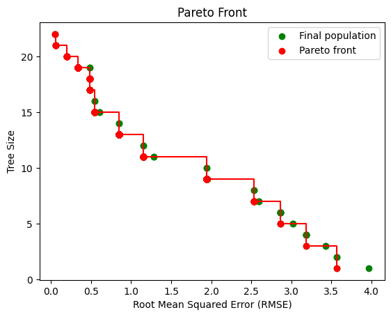
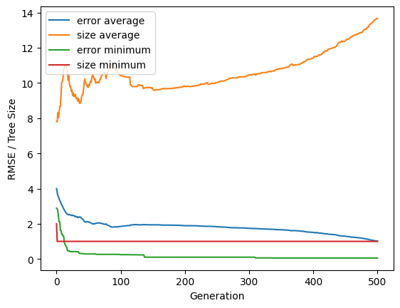

# Symbolic Regression with Multi-Objective Genetic Programming

Recovering an unknown function from samples by evolving mathematical expression trees, trading off accuracy against expression size.

## Problem

Given 1,000 evenly spaced samples of

$$f(x) = 5x^4 - 4x^3 + 3x^2 - 2x, \quad x \in [-1, 1]$$

find a closed-form expression that reproduces it, without telling the search what form the answer takes. A good answer should be both accurate and small, so the search optimizes two objectives at once:

1. **RMSE** between the candidate expression and the samples
2. **Tree size** (number of nodes in the expression)

## Approach

Built with [DEAP](https://github.com/DEAP/deap).

| Component | Choice |
|---|---|
| Primitives | `add`, `subtract`, `multiply`, `negative`, `sin`, `cos` |
| Terminals | `x`, random integer constant in {−1, 0, 1} |
| Initialization | Ramped half-and-half, depth 1–5 |
| Crossover | One-point, probability 0.5 |
| Mutation | Uniform subtree, probability 0.2 |
| Bloat control | Maximum tree height 17 |
| Selection | NSGA-II over (RMSE, tree size), with duplicate trees removed first |
| Evolution | (μ + λ) with μ = 500, λ = 1,000, 500 generations |
| Seed | 42 |

**Why NSGA-II with de-duplication.** A plain tournament compares the two objectives lexicographically, so tree size only breaks ties and trees bloat. NSGA-II ranks by Pareto dominance, making size a real objective, and is elitist under (μ + λ). Identical copies of one tree share a crowding distance that gets overwritten, which can drop the best tree and collapse the population onto a trivial expression, so duplicates are removed before selection.

## Results

| Metric | Value |
|---|---|
| Best RMSE in initial population | 2.89 |
| Best RMSE found | **0.053** (98% lower) |
| Size of best expression | 22 nodes |
| Area under Pareto front | 37.24 |

The best RMSE never increases between generations, and the best expression survives into the final population.

Best expression found:

```
multiply(add(x, multiply(multiply(x, x), add(x, x))),
         add(add(add(x, -1), sin(x)), add(-1, sin(sin(x)))))
```

which is $(x + 2x^3)\,(x - 2 + \sin x + \sin(\sin x))$.

### Pareto front

The front runs from a 1-node expression (RMSE ≈ 3.6) to the 22-node best (RMSE 0.053).



### Convergence



### Effect of population size and generations

Same seed, NSGA-II selection:

| μ / λ / generations | Best RMSE | Tree size | Runtime |
|---|---|---|---|
| 50 / 100 / 100 | 0.544 | 16 | a few seconds |
| 200 / 400 / 200 | 0.333 | 46 | 22 s |
| 300 / 600 / 300 | 0.255 | 28 | 53 s |
| 500 / 1000 / 200 | 0.102 | 22 | 63 s |
| **500 / 1000 / 500** | **0.053** | **22** | 170 s |

## Running it

```bash
pip install -r requirements.txt
jupyter notebook symbolic_regression_mogp.ipynb
```

The evolution cell takes about 3 minutes.
